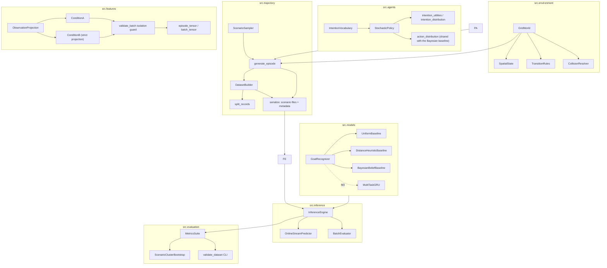

# System Architecture and Module Design

## 1. High-Level Modular Design

---

## 2. Package & Class Contracts

### 2.1 `src.environment`
- **`GridWorld`**:
  - `__init__(width: int, height: int, obstacles: list[tuple[int, int]], targets: list[Target])`
  - `reset(seed: Optional[int]) -> Observation`
  - `step(actions: dict[int, Action]) -> StepResult`
  - Manages spatial bounds, wall collisions, multi-agent conflict resolution, and termination criteria.

### 2.2 `src.agents`
- **`StochasticPolicy`** (`src/agents/policy.py`):
  - `select_intention(goal, current, history, blocked_count, obstacles=None, bounds=None) -> str`
  - `select_action(intention, goal, current, peers=(), policy_sensing_radius=3, obstacles=None, bounds=None) -> str`
  - `intention_distribution(...) -> Dict[str, float]`, `action_distribution(...) -> Dict[str, float]`
  - `reset()`: clears `prev_intention`, `dwell_remaining`, `blocked_count`.
- **Intention generation contract**: intentions come from a persistent, stochastic, history-aware softmax
  $$P(I_t \mid S_t, G, H_t, I_{t-1}) = \operatorname{softmax}(U/\tau)$$
  whose utility has five independent additive factors — `log behavior_weights`
  (read from `configs/env_default.yaml`), goal-relative lateral preference, local
  obstacle clearance, recent behavioural history, and previous-intention
  persistence — plus a detour-utility boost after $k_{\text{blocked}} \ge 2$
  consecutive blocked steps. Minimum dwell $D_{\min}$ (configurable, default 4)
  enforces temporal commitment and is interrupted by a blocking streak. No single
  geometric threshold determines the label; the triviality gate (PROJECT_SPEC §5,
  M2 §6) is what enforces this empirically.
- **Intentions are behaviours, not just labels**: `DETOUR_LEFT` and
  `DETOUR_RIGHT` drift to opposite sides of the goal vector, so the two classes
  are observationally distinguishable (regression-tested in
  `tests/test_agents.py::test_detour_left_and_right_are_behaviourally_distinct`).
- **Shared action model**: `action_distribution` is module-level so the Bayesian
  baseline scores observations with exactly the distribution that generated them.
  `select_action` samples from the same object, optionally re-weighting moves
  into cells occupied by peers inside `policy_sensing_radius`.
- **Policy sensing ≠ observer visibility**: `policy_sensing_radius` only affects
  local reactivity; the research observer stays global.

### 2.3 `src.trajectory`
- **`dataset.py`** — the single entry point from config to dataset:
  - `DatasetConfig.from_yaml(...)` / `.config_hash()`: typed view of `configs/env_default.yaml`.
  - `sample_scenario(cfg, scenario_index, master_seed) -> ScenarioSpec`: randomized obstacles with full-connectivity validation, $K$ separated targets, agent starts (peers spawned near the focal agent).
  - `generate_episode_record(...)`: one episode with observable steps + `privileged_ground_truth`, plus `scenario_spec` / `seeds` / `config_hash` addressability metadata.
  - `generate_dataset(cfg, master_seed, ...)`: deterministic dataset from the master seed via a `hashlib` seed hierarchy (`derive_seed`).
  - `reconstruct_episode_record(record, cfg)`: rebuilds an episode from its serialized metadata and raises on a `config_hash` mismatch (M2 test 3e).
  - `split_records(...)`: scenario-level split + `assert_no_scenario_leakage`.
  - `observable_record(record, masked=False)` / `privileged_record(record)` / `strip_privileged(record)` / `dataset_hash(records)`.
- **`generator.py`** — `generate_episode(...)` rollout primitive (deterministic agent iteration order, no global RNG) and the documented CLI (`python -m src.trajectory.generator`).
- **`scenarios.py`** — `ScenarioConfig` with a canonical `scenario_id` (SHA-256), `split_dataset`, `assert_no_scenario_leakage`.
- **`serialize.py`** — on-disk schema (DATASET_SCHEMA.md): `write_dataset`, `iter_observations` (the only supported loader path), `validate_scenario_file`.
- **Intention triviality probe** — implemented as the frozen M2 protocol in `verification/m2/section6_triviality_test.py` (P0 majority / P1 geometry / P2 geometry+previous behaviour / P3 stacked history), which is the deliverable ARCHITECTURE previously called `src/evaluation/triviality_probe.py`. The earlier exploratory version is archived at `verification/m2/archive/triviality_probe_exploratory.py`.
- **Information isolation guard** (`src/features/observations.py`):
  - `validate_batch(batch)` asserts `set(batch.keys()).issubset(OBSERVABLE_FIELDS)` and raises `InformationIsolationError` on any privileged field; `assert_condition_b_projection` proves Condition B is the projection of Condition A; `episode_tensor` in `src/features/tensorize.py` is the final stage, so a privileged column cannot reach a model input.

### 2.4 `src.features`
- **`observations.py`**: builds Condition A, projects Condition B from it via an explicit allowlist, and hosts the isolation guard.
- **`tensorize.py`**:
  - `episode_tensor(observation) -> [T, F]`: focal position and `position_before`, realized-action one-hot, per-target relative vectors plus Manhattan/Euclidean distances; in Condition A also the `blocked` flag and per-peer relative vectors/distances.
  - `feature_names(observation)`: column names, used by ablations (RQ6) and by the isolation audit.
  - `batch_tensor(observations) -> [B, T, F]` with zero padding.
  - Both call `validate_batch` first, so the tensor stage cannot be reached with privileged data.
- **`ObservationCorrupter`** (RQ5, M3): Gaussian coordinate jitter and random observation dropouts applied at load time without mutating the stored dataset.

### 2.5 Baselines and models
Implemented (M2, `src/evaluation/baselines.py`), all answering `P(G | O_{1:t})` so
their metrics are directly comparable:
- **`UniformBaseline`**: constant $1/|\mathcal{G}|$ with a seeded infinitesimal jitter so that top-1 is a fair random guess (expected accuracy $1/K$) rather than a constant class.
- **`DistanceHeuristicBaseline`**: $\operatorname{softmax}(-\beta \cdot d(p_t, g))$ with `distance_metric` in {`shortest_path` (obstacle-aware BFS, default), `manhattan`}.
- **`BayesianBeliefBaseline`**: recursive joint belief $b_t(G, I_t)$ per PROJECT_SPEC §2.3, with the *generative* action model as its emission and the observable `blocked` flag when available (Condition A) or a block-rate mixture when it is not (Condition B).
- `belief_trajectory(...)`: per-step goal posteriors used for the $\alpha$ sweep and NTCD.

Implemented (M3, `src/models/gru.py`): `MultiTaskGRU`, a gated recurrent unit in
NumPy (the CPU-only PyTorch wheel is outside this environment's allowed hosts)
with a goal head and an intention head. Its backprop-through-time is verified by
a numerical gradient check (`tests/test_gru.py`), and it consumes the same
timing-contract frames as the probes. `experiments/learned/run_gru.py` trains it
on the train split and compares it to the baselines on the held-out test
scenarios, plus the RQ2 interaction contrast (Condition A vs noise-masked D),
where the recurrent model — unlike the 5-frame probe — makes real use of peer
trajectories over time (goal accuracy A-D +0.18, significant).

Earlier plan text — `RecurrentGoalModel` (PyTorch GRU) with heads for
$P(G)$, $P(I_t \mid G, I_{t-1})$ and $P(A_{t+1} \mid G, I_t)$, plus the
cost-difference likelihood variant of Baseline C.

### 2.6 `src.evaluation`
- **`metrics.py`** (implemented):
  - `top_k_accuracy`, `macro_f1_from_predictions` (NumPy; cross-checked against scikit-learn in `tests/test_metrics.py`), `nll`, `brier_score`.
  - `ntcd_episode` / `ntcd` / `convergence_failure_rate` with the explicit stability-window and never-correct ($\text{NTCD}=1$) semantics of EXPERIMENT_PLAN §1.2.
  - `scenario_bootstrap_ci` and `paired_gap_ci`: **scenario-cluster** bootstrap over frozen predictions, so the interval brackets the point estimate (a retraining bootstrap does not — that was the defect in the first M2 §6 run).
  - `evaluate_goal_predictions(...) -> MetricBundle`: point estimates + CIs + counts.
- **`validate_dataset.py`** (implemented): CLI auditing a dataset directory for schema version, privileged leakage inside `observations`, bounds/obstacle violations, cross-split scenario overlap and checksum mismatches.
- **Reporting standard**: mean $\pm$ std across 5 seeds; scenario-level bootstrap CIs; CPU-only reported numbers.
- **`ExperimentRunner`** (M3): CLI harness running evaluation sweeps across observation horizons, noise levels, and seeds.

---

## 3. Automated Test Suite Architecture (`tests/`)
Implemented and passing (`python -m pytest`: 109 tests in `tests/` plus 25 gate
tests in `verification/m2/`, 134 total):
- `test_environment.py`: grid bounds, obstacle/boundary collision, simultaneous movement, same-destination, swap, 4- and 6-agent rotations (with the bipartiteness argument for why odd cycles cannot occur), staggered convoy, agent-ID-priority freedom, determinism, pathfinding utilities.
- `test_agents.py`: distribution validity, `behavior_weights` actually driving the policy, goal / history / previous-intention dependence, minimum dwell, blocked-streak response, detour left/right mirror asymmetry, obstacle- and bound-aware action model, seed reproducibility, reset semantics, peer avoidance.
- `test_dataset.py`: config round-trip and hashing (including the RQ2 interaction parameters), seed derivation, connectivity and target separation, per-episode hidden-goal variation, **peer-goal independence** (the elimination shortcut that would trivialise RQ2's contrast is asserted against), step-level observable/privileged fields, scenario-level split with zero overlap and a constructed-leakage failure, projection isolation with injection failures, reproducibility and addressability.
- `test_timing_contract.py` (11): mutation-proof that `O_t` ignores the present and future, the step-key allowlist, prefix equivalence, goal independence, and a leakage canary that proves the test can actually fail.
- `test_interaction.py` (13): scenario-family structure and rotation, the focal peer-blocked rate against the M1 default, the peer-influence measure, and the peer/interaction feature channels (response to peer placement, exact masking behaviour, timing-contract compliance, shuffled-peer control geometry).
- `test_gru.py` (2): BPTT vs finite differences, and above-chance learning on real episodes.
- `test_figures.py` (3): the report figure builder runs end-to-end on real episodes, the showcase selector picks the most-interacted episode, and the Bayesian posterior stays normalized and favours the true goal by episode end.

`src/visualization/overview_figure.py` renders ``figures/fig1_overview.png``
(``python verification/make_figures.py``): scenario layout, trajectories with
interaction markers, posterior-over-goals evolution, and the RQ2 contrast forest
plot. Nothing in the figure is hardcoded; it is rebuilt from the dataset and
``experiments/multi_agent/interaction_contrast.json``. There is no communication
channel in the environment, so the figure visualises blocking, perturbation and
inference rather than dialogue.
- `test_baselines.py`: distribution contracts, fair random guess, Manhattan-vs-shortest-path disagreement, belief normalization, posterior convergence, blocked-flag sensitivity, Condition B execution, ordering wiring, and an explicit CPU-only path assertion.
- `test_metrics.py`: top-k / NLL / Brier corner cases, macro-F1 agreement with scikit-learn, NTCD semantics (never-correct ⇒ 1, stability window, partial-horizon), cluster-bootstrap bracketing, paired-gap sanity.
- `test_termination.py`: all three termination reasons reached by construction with stub policies (goal reached, goal reached before the horizon, max steps, deadlock limit, and the "every agent must be blocked" requirement), plus strict prefix truncation.
- `test_serialization.py`: on-disk schema conformance, velocity deltas, loader-side observable projection, privileged-injection and out-of-bounds rejection, cross-split overlap detection, checksum tampering, and an end-to-end run of both documented CLIs.
